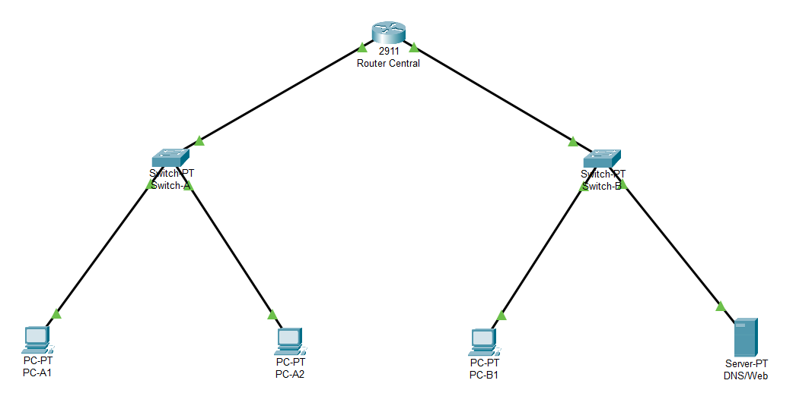
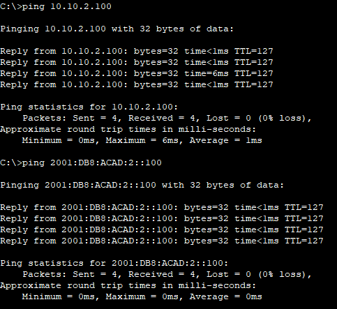
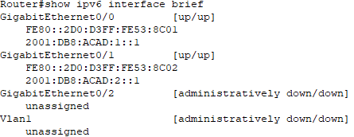
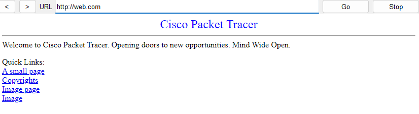

# 🌐 Implementação de Rede Dual-Stack (IPv4 e IPv6)

Projeto prático desenvolvido no **Cisco Packet Tracer** como parte do meu portfólio de redes e segurança da informação, aplicando os conceitos da certificação **Networking Basics** da Cisco Networking Academy.

## 🎯 Objetivo
Projetar, configurar e validar uma infraestrutura corporativa operando em pilha dupla (**Dual-Stack**), permitindo a coexistência simultânea dos protocolos **IPv4** e **IPv6** entre duas redes locais (LAN A e LAN B) interligadas por um roteador central, com resolução de nomes DNS e acesso a servidor Web.

## 🏗️ Topologia da Rede

### Equipamentos Utilizados
* **Roteador Central:** Cisco 2911 (`Router-Central`)
* **Switches de Acesso:** 2x Cisco 2960 (`Switch-A` e `Switch-B`)
* **Estações de Trabalho:** 3x PCs (`PC-A1`, `PC-A2` na LAN A e `PC-B1` na LAN B)
* **Servidor de Serviços:** 1x Servidor (`Server-DNS-Web` na LAN B)

## 📋 Tabela de Endereçamento Dual-Stack (IPv4 e IPv6)

### Endereçamento IPv4 (`10.10.1.0/24` e `10.10.2.0/24`)

| Segmento | Dispositivo | Interface | Endereço IPv4 | Máscara | Gateway Padrão | DNS IPv4 |
| :--- | :--- | :--- | :--- | :--- | :--- | :--- |
| **LAN A** | **Router-Central** | GigabitEthernet0/0 | `10.10.1.1` | `255.255.255.0` | — | — |
| **LAN A** | **PC-A1** | FastEthernet0 | `10.10.1.100` | `255.255.255.0` | `10.10.1.1` | `10.10.2.10` |
| **LAN A** | **PC-A2** | FastEthernet0 | `10.10.1.101` | `255.255.255.0` | `10.10.1.1` | `10.10.2.10` |
| **LAN B** | **Router-Central** | GigabitEthernet0/1 | `10.10.2.1` | `255.255.255.0` | — | — |
| **LAN B** | **PC-B1** | FastEthernet0 | `10.10.2.100` | `255.255.255.0` | `10.10.2.1` | `10.10.2.10` |
| **LAN B** | **Server-DNS-Web** | FastEthernet0 | `10.10.2.10` | `255.255.255.0` | `10.10.2.1` | `10.10.2.10` |

### Endereçamento IPv6 (`2001:DB8:ACAD:1::/64` e `2001:DB8:ACAD:2::/64`)

| Segmento | Dispositivo | Interface | Endereço IPv6 | Prefixo | Gateway Padrão IPv6 | DNS IPv6 |
| :--- | :--- | :--- | :--- | :--- | :--- | :--- |
| **LAN A** | **Router-Central** | GigabitEthernet0/0 | `2001:DB8:ACAD:1::1` | `/64` | — | — |
| **LAN A** | **PC-A1** | FastEthernet0 | `2001:DB8:ACAD:1::10` *(ou SLAAC)* | `/64` | `2001:DB8:ACAD:1::1` | `2001:DB8:ACAD:2::100` |
| **LAN A** | **PC-A2** | FastEthernet0 | `2001:DB8:ACAD:1::11` *(ou SLAAC)* | `/64` | `2001:DB8:ACAD:1::1` | `2001:DB8:ACAD:2::100` |
| **LAN B** | **Router-Central** | GigabitEthernet0/1 | `2001:DB8:ACAD:2::1` | `/64` | — | — |
| **LAN B** | **PC-B1** | FastEthernet0 | `2001:DB8:ACAD:2::10` *(ou SLAAC)* | `/64` | `2001:DB8:ACAD:2::1` | `2001:DB8:ACAD:2::100` |
| **LAN B** | **Server-DNS-Web** | FastEthernet0 | `2001:DB8:ACAD:2::100` | `/64` | `2001:DB8:ACAD:2::1` | `2001:DB8:ACAD:2::100` |

## 🛠️ Tecnologias e Conceitos Aplicados
* **Arquitetura Dual-Stack:** Operação simultânea das pilhas IPv4 e IPv6 nas mesmas interfaces físicas do roteador e dos hosts.
* **Roteamento IPv6 (`ipv6 unicast-routing`):** Habilitação do encaminhamento de pacotes IPv6 via Cisco IOS CLI e atribuição de endereços Global Unicast (`/64`).
* **Autoconfiguração SLAAC / Endereçamento IPv6:** Suporte à atribuição dinâmica via *Stateless Address Autoconfiguration* (SLAAC) e endereçamento estático no servidor.
* **Serviços DNS (Registros A e AAAA) e HTTP:** Resolução de nomes e hospedagem web respondendo tanto para consultas IPv4 (`10.10.2.10`) quanto IPv6 (`2001:DB8:ACAD:2::100`).

## ✅ Testes e Validação

### 1. Conectividade Dual-Stack (`ping` IPv4 e IPv6)
Testes de alcance entre estações da LAN A e os dispositivos da LAN B nos dois protocolos com 0% de perda de pacotes:

### 2. Auditoria de Interfaces e Rotas IPv6 (`CLI`)
Verificação via terminal do roteador Cisco 2911 confirmando os endereços Global Unicast, Link-Local (`FE80::`) e o estado ativo (`up/up`) das interfaces:

### 3. Resolução DNS e Acesso Web
Acesso à página hospedada no `Server-DNS-Web` diretamente pelo navegador das estações de trabalho:

## 📂 Como executar o projeto
1. Faça o download do arquivo `projeto3-rede-dual-stack.pkt` neste repositório.
2. Abra o arquivo utilizando o **Cisco Packet Tracer** (versão 8.0 ou superior).
